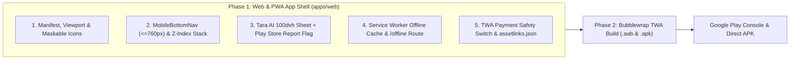

# Phase 1 Detailed Implementation Plan: Android App Shell, PWA & TWA Readiness (`ChapterReady.in`)

> **Status:** Approved Architecture Blueprint (Ready for Implementation)  
> **Target Package ID:** `in.chapterready.app`  
> **Target Repository:** `cbse_byCodex/apps/web`  
> **Distribution Target:** Google Play Store (`.aab` via Trusted Web Activity) + Direct Download `.apk`

---

## 1. Architecture & Scope Overview

Phase 1 transforms `@cbse/web` (`https://www.chapterready.in`) into an installable, Play Store-compliant **Progressive Web App (PWA)** and **Trusted Web Activity (TWA)** host without breaking any existing Next.js 15 Server Components, KaTeX math rendering, Three.js 3D Virtual Labs, or Cashfree/Razorpay UPI payment flows.



---

## 2. File-by-File Inventory (New vs. Modified)

### 2.1 New Files to Create
| File Path (relative to `cbse_byCodex/apps/web`) | Purpose |
| :--- | :--- |
| `app/manifest.ts` | Next.js Web App Manifest (`display: 'standalone'`, `portrait`, icons, shortcuts). |
| `scripts/generate-pwa-icons.mjs` | Generates `192x192`, `512x512`, maskable icons, and `apple-touch-icon.png` from `app/icon.svg`. |
| `public/icons/icon-192.png` | Standard 192×192 PNG launcher icon. |
| `public/icons/icon-512.png` | Standard 512×512 PNG Play Store / splash icon. |
| `public/icons/icon-maskable-192.png` | Android adaptive maskable 192×192 icon (80% safe zone on `#fffdf8` warm paper). |
| `public/icons/icon-maskable-512.png` | Android adaptive maskable 512×512 icon. |
| `public/.well-known/assetlinks.json` | Google Digital Asset Links file verifying `in.chapterready.app` domain ownership. |
| `components/MobileBottomNav.tsx` | Persistent 5-tab thumb-friendly bottom navigation bar + "More Tools" bottom sheet (`<= 760px`). |
| `app/offline/page.tsx` | Branded warm-paper offline fallback screen when student loses mobile data. |
| `public/sw.js` | Service Worker for asset caching, visited notes/cheatsheets caching, and offline fallback. |
| `components/ServiceWorkerRegistrar.tsx` | Client component that registers `/sw.js` in production and captures TWA referrer state. |
| `lib/twa.ts` | Utilities `isAndroidTwa()` and `getTwaPaymentsMode()` (`enabled` vs. `web_only` remote review switch). |

### 2.2 Existing Files to Modify
| File Path (relative to `cbse_byCodex/apps/web`) | Exact Changes |
| :--- | :--- |
| [`app/layout.tsx`](file:///c:/SagarV/Projects/chapterready-workspace/cbse_byCodex/apps/web/app/layout.tsx) | Export `viewport: Viewport` (`themeColor: '#171513'`, `viewportFit: 'cover'`), mount `<MobileBottomNav />` and `<ServiceWorkerRegistrar />`. |
| [`next.config.mjs`](file:///c:/SagarV/Projects/chapterready-workspace/cbse_byCodex/apps/web/next.config.mjs) | Add headers for `/.well-known/assetlinks.json` (`application/json`) and `/sw.js` (`Service-Worker-Allowed: /`, `no-cache`). |
| [`components/TaraWidget.tsx`](file:///c:/SagarV/Projects/chapterready-workspace/cbse_byCodex/apps/web/components/TaraWidget.tsx) | 1) Mobile `100dvh` full-screen drawer at `<= 640px`. 2) Reposition `.tara-bubble` above `MobileBottomNav`. 3) Add in-app `🚩 Report` button on AI messages for Google Play AI policy compliance. |
| [`app/globals.css`](file:///c:/SagarV/Projects/chapterready-workspace/cbse_byCodex/apps/web/app/globals.css) | Shift `.lesson-mobile-navigation` up above `MobileBottomNav` (`bottom: calc(70px + env(safe-area-inset-bottom))`) and add mobile bottom padding to `body`. |
| [`components/study-remix.module.css`](file:///c:/SagarV/Projects/chapterready-workspace/cbse_byCodex/apps/web/components/study-remix.module.css) | Shift `.miniPlayer` on mobile (`<= 760px`) above `MobileBottomNav` so it never collides with bottom tabs. |
| [`components/ProductCheckoutModal.tsx`](file:///c:/SagarV/Projects/chapterready-workspace/cbse_byCodex/apps/web/components/ProductCheckoutModal.tsx) | Add optional `NEXT_PUBLIC_TWA_PAYMENTS_MODE` guard (defaults to `enabled` so Cashfree/Razorpay UPI works natively; allows instant remote switch if needed during Play review). |
| [`components/PaywallModal.tsx`](file:///c:/SagarV/Projects/chapterready-workspace/cbse_byCodex/apps/web/components/PaywallModal.tsx) | Same `NEXT_PUBLIC_TWA_PAYMENTS_MODE` guard. |
| [`components/QuizPaywallModal.tsx`](file:///c:/SagarV/Projects/chapterready-workspace/cbse_byCodex/apps/web/components/QuizPaywallModal.tsx) | Same `NEXT_PUBLIC_TWA_PAYMENTS_MODE` guard. |

---

## 3. Detailed Workstream Specifications

### Workstream 1: PWA Manifest, Viewport, Maskable Icons & `assetlinks.json`

#### 1.1 `apps/web/app/manifest.ts`
Next.js 15 natively serves `/manifest.webmanifest` when `app/manifest.ts` is present:
```ts
import type { MetadataRoute } from 'next';

export default function manifest(): MetadataRoute.Manifest {
  return {
    id: '/',
    name: 'ChapterReady: CBSE Class 10 Notes, PYQs & Mock Papers',
    short_name: 'ChapterReady',
    description:
      'Textbook-faithful CBSE Class 10 NCERT notes, 1,669+ PYQs & Exemplar questions, 20 free 80-mark mock papers, 3D Science Lab, and Tara AI tutor.',
    start_url: '/dashboard?utm_source=twa',
    scope: '/',
    display: 'standalone',
    orientation: 'portrait',
    background_color: '#fffdf8',
    theme_color: '#171513',
    categories: ['education', 'books', 'productivity'],
    icons: [
      {
        src: '/icons/icon-192.png',
        sizes: '192x192',
        type: 'image/png',
        purpose: 'any',
      },
      {
        src: '/icons/icon-512.png',
        sizes: '512x512',
        type: 'image/png',
        purpose: 'any',
      },
      {
        src: '/icons/icon-maskable-192.png',
        sizes: '192x192',
        type: 'image/png',
        purpose: 'maskable',
      },
      {
        src: '/icons/icon-maskable-512.png',
        sizes: '512x512',
        type: 'image/png',
        purpose: 'maskable',
      },
    ],
    shortcuts: [
      {
        name: 'Question Bank (PYQs)',
        short_name: 'PYQs',
        description: 'Practice 1,669+ CBSE Board PYQs & NCERT Exemplar questions',
        url: '/questions?utm_source=twa_shortcut',
        icons: [{ src: '/icons/icon-192.png', sizes: '192x192' }],
      },
      {
        name: 'Free 80-Mark Mock Papers',
        short_name: 'Mock Papers',
        description: '20 full-length CBSE Class 10 Board Mock Test Papers',
        url: '/exam-papers?utm_source=twa_shortcut',
        icons: [{ src: '/icons/icon-192.png', sizes: '192x192' }],
      },
      {
        name: 'Formula Cheatsheets',
        short_name: 'Formulas',
        description: '1-Page Maths & Science Formula & Reaction Sheets',
        url: '/formula-cheatsheets?utm_source=twa_shortcut',
        icons: [{ src: '/icons/icon-192.png', sizes: '192x192' }],
      },
    ],
  };
}
```

#### 1.2 Viewport & Apple Web App Metadata in [`app/layout.tsx`](file:///c:/SagarV/Projects/chapterready-workspace/cbse_byCodex/apps/web/app/layout.tsx)
Add the Next.js `Viewport` export so Android Chrome & TWA color the system status bar and respect notch/gesture insets:
```ts
import type { Metadata, Viewport } from 'next';

export const viewport: Viewport = {
  themeColor: '#171513',
  width: 'device-width',
  initialScale: 1,
  maximumScale: 5,
  viewportFit: 'cover',
};
```

#### 1.3 Digital Asset Links (`public/.well-known/assetlinks.json`)
Required by Android to verify that `https://www.chapterready.in` authorizes the Android app `in.chapterready.app` to open in full-screen standalone mode without a browser address bar:
```json
[
  {
    "relation": [
      "delegate_permission/common.handle_all_urls",
      "delegate_permission/common.use_as_origin"
    ],
    "target": {
      "namespace": "android_app",
      "package_name": "in.chapterready.app",
      "sha256_cert_fingerprints": [
        "REPLACE_WITH_UPLOAD_KEYSTORE_SHA256_IN_PHASE_2",
        "REPLACE_WITH_PLAY_APP_SIGNING_SHA256_IN_PHASE_2"
      ]
    }
  }
]
```

---

### Workstream 2: Native-Feel Mobile Bottom Navigation Bar (`MobileBottomNav.tsx`)

#### 2.1 The Problem It Solves
Currently, at `@media (max-width: 760px)` ([`platform-remix.css#L2603`](file:///c:/SagarV/Projects/chapterready-workspace/cbse_byCodex/apps/web/app/platform-remix.css#L2603)), `.student-topbar-nav` is hidden (`display: none`). On a phone, students have no persistent tab bar to jump between **Dashboard**, **Subjects**, **PYQ Question Bank**, **Mock Papers**, and **Study Tools**.

#### 2.2 Component Design (`components/MobileBottomNav.tsx`)
- **Visibility:** Displayed only on screens `<= 760px` (`display: none` on desktop `> 760px` and `display: none !important` in `@media print`).
- **5 Thumb-Zone Tabs:**
  1. **Home** (`/dashboard`) — Icon: `LayoutDashboard` / Home SVG
  2. **Subjects** (`/subjects`) — Icon: `BookOpen`
  3. **PYQ Bank** (`/questions`) — Icon: `FileQuestion`
  4. **Mocks** (`/exam-papers`) — Icon: `ClipboardCheck`
  5. **More** (Toggles a slide-up Neo-Brutalist Quick-Access Sheet) — Icon: `Grid` / `Sparkles`
- **"More" Slide-Up Sheet Contents:**
  - ⚡ **1-Page Formula Cheatsheets** (`/formula-cheatsheets`)
  - 🔬 **NCERT Activities & Diagrams** (`/activities-and-diagrams`)
  - 🧪 **3D Virtual Science Lab** (`/virtual-lab`)
  - 🎯 **Board Score Predictor** (`/tools/readiness-predictor`)
  - 📐 **Trig Magic Hexagon** (`/tools/trig-magic-hexagon`)
  - 🎮 **Study Arcade Games** (`/games`)
  - 🛍️ **ChapterReady Store** (`/store`)
  - ❌ **My Mistakes Notebook** (`/my-mistakes`)
  - 👨‍👩‍👧 **Parent Progress Summary** (`/parent-summary`)

#### 2.3 Mobile Bottom Z-Index & Vertical Stacking Geometry (`<= 760px`)
To guarantee **zero visual collisions** between fixed bars at the bottom of a phone screen:

| Element | CSS File | Desktop Position | New Mobile (`<= 760px`) Position | `z-index` |
| :--- | :--- | :--- | :--- | :--- |
| **`MobileBottomNav`** | `MobileBottomNav.tsx` | Hidden | `bottom: 0; left: 0; right: 0; height: calc(62px + env(safe-area-inset-bottom))` | `900` |
| **`.lesson-mobile-navigation`** | [`globals.css#L3219`](file:///c:/SagarV/Projects/chapterready-workspace/cbse_byCodex/apps/web/app/globals.css#L3219) | Hidden | `bottom: calc(68px + env(safe-area-inset-bottom))` | `890` |
| **Study Remix `.miniPlayer`** | [`study-remix.module.css#L1807`](file:///c:/SagarV/Projects/chapterready-workspace/cbse_byCodex/apps/web/components/study-remix.module.css#L1807) | `bottom: 18px` | `bottom: calc(68px + env(safe-area-inset-bottom))` (`138px` when `.miniPlayerLessonOffset`) | `895` |
| **Tara Trigger `.tara-bubble`** | [`TaraWidget.tsx#L1058`](file:///c:/SagarV/Projects/chapterready-workspace/cbse_byCodex/apps/web/components/TaraWidget.tsx#L1058) | `bottom: 24px; right: 24px` (`68px`) | `bottom: calc(74px + env(safe-area-inset-bottom)); right: 14px; width: 56px; height: 56px` | `950` |
| **Tara Chat `.tara-window`** | [`TaraWidget.tsx#L1083`](file:///c:/SagarV/Projects/chapterready-workspace/cbse_byCodex/apps/web/components/TaraWidget.tsx#L1083) | `bottom: 104px; right: 24px` | `inset: 0; width: 100%; height: 100dvh; border-radius: 0` | `10000` |

---

### Workstream 3: Tara AI Mobile Sheet (`100dvh`) & Google Play AI Compliance (`🚩 Report`)

#### 3.1 Mobile Soft-Keyboard & `100dvh` Fix
In [`TaraWidget.tsx`](file:///c:/SagarV/Projects/chapterready-workspace/cbse_byCodex/apps/web/components/TaraWidget.tsx#L1083), `.tara-window` currently uses `max-height: calc(100vh - 140px)`. On Android Chrome/TWA, opening the soft keyboard shrinks the visual viewport (`dvh`), not the layout viewport (`vh`).
- **Fix:** Add `@media (max-width: 640px)` rules so `.tara-window` becomes a full-screen edge-to-edge sheet (`inset: 0; width: 100%; height: 100dvh; max-height: 100dvh; border: none; border-radius: 0;`) with `padding-bottom: calc(10px + env(safe-area-inset-bottom))` on `.tara-input-bar`.

#### 3.2 In-App AI Response Reporting (Mandatory Google Play Policy)
Google Play's **AI-Generated Content Policy** requires every app with a generative AI chatbot to let users report/flag offensive or inaccurate AI responses **inside the app without leaving the current screen**.
- **UI Addition in [`TaraWidget.tsx`](file:///c:/SagarV/Projects/chapterready-workspace/cbse_byCodex/apps/web/components/TaraWidget.tsx#L953-L964):**
  - Below each `assistant` message bubble, add a compact action row:
    - `📖 based on your Class 10 notes` (existing citation badge)
    - `🚩 Report` button (`aria-label="Report this AI response"`).
  - Clicking `🚩 Report` reveals 3 quick pills: `Inaccurate formula/fact`, `Confusing explanation`, `Inappropriate content`.
  - Selecting a pill sends a `POST /api/feedback` request ([`app/api/feedback/route.ts`](file:///c:/SagarV/Projects/chapterready-workspace/cbse_byCodex/apps/web/app/api/feedback/route.ts)) with:
    ```json
    {
      "category": "ai_tutor_report",
      "message": "[AI Report: Inaccurate formula/fact] Message ID: ... | Snippet: ...",
      "pageUrl": "/chapters/...",
      "rating": 1
    }
    ```
  - Replaces the pill row with `✓ Reported — thank you for keeping Tara accurate!`.

---

### Workstream 4: Service Worker Offline Caching & `/offline` Fallback

#### 4.1 Why It's Required
1. **Google Play TWA Requirement:** Bubblewrap / Play Store review checks that the TWA does not crash or show Chrome's raw `ERR_INTERNET_DISCONNECTED` dinosaur page when airplane mode is toggled.
2. **Student Experience:** Class 10 students commuting or studying on unstable mobile networks can still view previously opened Chapter Notes and Formula Cheatsheets.

#### 4.2 Caching Strategy (`public/sw.js`)
- **Cache Name:** `chapterready-shell-v1` & `chapterready-Runtime-v1`
- **Precache on Install:** `/offline`, `/icons/icon-192.png`, `/brand/chapterready-logo.svg`
- **Bypass / Never Cache:**
  - Any non-`GET` request
  - `/api/*`, `/v1/*`, `/login`, `/register`, `/orders`, `/store` checkout calls
  - Cashfree (`sdk.cashfree.com`) and Razorpay (`checkout.razorpay.com`) scripts
- **Stale-While-Revalidate:** Static visual assets (`/figures/*`, `/activity-illustrations/*`, `/icons/*`, `.woff2` KaTeX fonts).
- **Network-First with Cache Fallback:** HTML navigation requests (`request.mode === 'navigate'`). If offline, serve cached page if previously visited; otherwise serve `/offline`.

---

### Workstream 5: TWA Payment Mode Safety Switch (`lib/twa.ts`)

#### 5.1 How It Works
Your existing Cashfree v3 + Razorpay modal in [`ProductCheckoutModal.tsx`](file:///c:/SagarV/Projects/chapterready-workspace/cbse_byCodex/apps/web/components/ProductCheckoutModal.tsx) works 100% natively in TWA (including GPay/PhonePe/Paytm UPI intents). To give you complete protection during Google Play Console reviews without ever needing to rebuild the `.aab`:

```ts
// apps/web/lib/twa.ts
const TWA_STORAGE_KEY = 'cr_is_android_twa';

export function detectAndPersistTwaSession(): boolean {
  if (typeof window === 'undefined') return false;
  try {
    const isTwaReferrer = document.referrer.startsWith('android-app://');
    const hasTwaParam = new URLSearchParams(window.location.search).get('utm_source') === 'twa';
    if (isTwaReferrer || hasTwaParam) {
      window.sessionStorage.setItem(TWA_STORAGE_KEY, '1');
      return true;
    }
    return window.sessionStorage.getItem(TWA_STORAGE_KEY) === '1';
  } catch {
    return false;
  }
}

export function isTwaWebOnlyPaymentMode(): boolean {
  // Default is 'enabled' (full Cashfree/Razorpay UPI inside TWA).
  // Can be flipped to 'web_only' via Vercel env var during Play Console review if ever needed.
  const mode = process.env.NEXT_PUBLIC_TWA_PAYMENTS_MODE ?? 'enabled';
  if (mode !== 'web_only') return false;
  return detectAndPersistTwaSession();
}
```

When `NEXT_PUBLIC_TWA_PAYMENTS_MODE=enabled` (the default), 100% of your Cashfree & Razorpay UPI flows run normally inside the Android app. If you ever set `NEXT_PUBLIC_TWA_PAYMENTS_MODE=web_only` on Vercel during a Play Store review window, the checkout modal displays a clean notice: *"Unlocked packs sync automatically across web and app — visit www.chapterready.in in your browser to manage study packs."*

---

## 4. Verification & Acceptance Criteria (Focused Checks per Rule 1.3)

1. **TypeScript Compilation:**
   ```bash
   cd cbse_byCodex && npx tsc --noEmit -p apps/web
   ```
2. **Manifest & Asset Links Verification:**
   - `GET /manifest.webmanifest` returns HTTP 200 with valid icons and `display: "standalone"`.
   - `GET /.well-known/assetlinks.json` returns HTTP 200 with `application/json`.
   - `GET /offline` renders the branded offline recovery page.
3. **Mobile Viewport (`390×844` Pixel 7 / iPhone 14 viewport) Checks:**
   - `MobileBottomNav` renders at bottom with all 5 tabs and opens the "More Tools" sheet cleanly.
   - `.tara-bubble` sits above `MobileBottomNav` with zero overlap.
   - Opening `TaraWidget` on mobile renders full-screen (`100dvh`) and shows the `🚩 Report` action on assistant replies.
   - `PrintableExamPaper` `@media print` hides `MobileBottomNav` completely.
